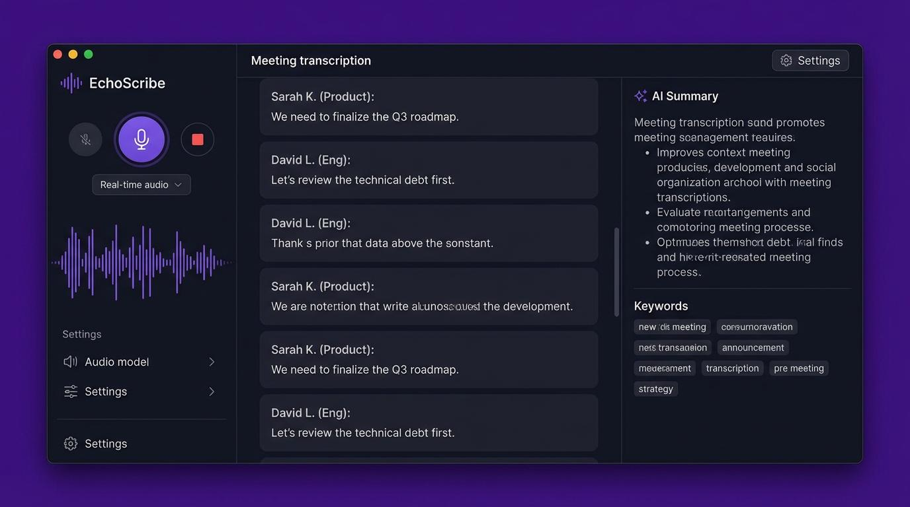

# Jifar

**Private meeting recorder and Afaan Oromo transcription and notes for Linux.**

Jifar records your meetings (your microphone and the other participants' audio, on separate tracks), transcribes them in Afaan Oromo, and turns the transcript into a summary with key points, decisions and action items. Everything is stored on your computer. There's no account and no telemetry, and your recordings are never uploaded to Jifar servers.



> **Status: early development (pre-V1).** The UI shell runs on mock data, and the Rust core is scaffolded. Audio capture (M1) is next. See [the plan](docs/PLAN.md).

## Features (V1 target)

- **Record**: manual start/stop from the app or the system tray. Mic and system audio go to separate, time-aligned Opus tracks. Recording never needs the internet.
- **Transcribe**: Afaan Oromo transcription **after the meeting ends**, with automatic retry if you're offline. Segments are labelled *Me* / *Others* and you can edit them.
- **Notes**: summary, key points, decisions and action items, each linked back to the transcript.
- **History**: search across all meetings, playback from any segment, export to Markdown or text.
- **Private by default**: local storage under `~/.local/share/jifar`, API keys in the OS keyring, no telemetry.

Out of scope for V1: real-time transcription, accounts, team features, cloud sync, calendar or bots, Windows/macOS. See [SPEC §4](docs/SPEC.md#4-out-of-scope-v1).

## Tech stack

| Layer | Choice |
| ----- | ------ |
| App shell | [Tauri 2](https://tauri.app) (WebKitGTK on Linux) |
| Core | Rust (edition 2024): PipeWire/PulseAudio capture, Opus, SQLite + FTS5 |
| UI | React, TypeScript, Vite, Tailwind CSS v4, shadcn/ui, TanStack Query, Zustand |
| IPC | Typed Rust ↔ TS bindings generated by [tauri-specta](https://github.com/specta-rs/tauri-specta) |
| AI | Pluggable providers: Addis Scribe (ASR) and a cloud LLM first, local models later |

## Getting started

Supported: Ubuntu 22.04 / 24.04 (other modern Linux distros with PipeWire or PulseAudio should work).

### Prerequisites

```bash
# Rust
curl --proto '=https' --tlsv1.2 -sSf https://sh.rustup.rs | sh

# System libraries
sudo apt install libwebkit2gtk-4.1-dev libayatana-appindicator3-dev librsvg2-dev \
  libpipewire-0.3-dev libpulse-dev libopus-dev libssl-dev build-essential pkg-config clang \
  gstreamer1.0-plugins-base gstreamer1.0-plugins-good

# Node.js 24+ (pnpm comes via corepack)
corepack enable

# ONNX Runtime for the VAD chunker (loaded at runtime, not linked)
export ORT_DYLIB_PATH=$(scripts/fetch-onnxruntime.sh)
```

### Run

```bash
pnpm install
pnpm tauri dev      # desktop app (Rust core + UI)
pnpm dev            # UI only in a browser at http://localhost:1420, with mock data
```

### Checks (same as CI)

```bash
pnpm lint && pnpm build                            # Biome, tsc, Vite
cargo fmt --all --check
cargo clippy --workspace --all-targets -- -D warnings
cargo test --workspace                             # also regenerates src/bindings.ts;
                                                   # Silero tests skip without ORT_DYLIB_PATH
scripts/check-deps.sh                              # recording must not depend on network code
```

## Project layout

```
crates/
  jifar-audio/      capture → ring buffer → Opus; offline VAD chunking
  jifar-store/      SQLite, migrations, full-text search
  jifar-queue/      persistent transcription job queue with retries
  jifar-providers/  ASR / notes provider traits + implementations (only crate with network access)
  jifar-core/       domain types, orchestration, XDG paths
src-tauri/          Tauri app: commands, window, tray (thin layer over the crates)
src/                React UI
  bindings.ts       generated by tauri-specta. Do not edit
  lib/mock-backend.ts  in-browser stand-in for the Rust core
docs/
  SPEC.md           requirements and architecture (source of truth)
  PLAN.md           milestones, tasks, risks, decision log
  DESIGN.md         UI design
```

## Documentation

- [**SPEC.md**](docs/SPEC.md): what V1 does and how it's built. Requirement IDs (`FR-*`, `NFR-*`) are referenced in commits.
- [**PLAN.md**](docs/PLAN.md): milestones M0–M5, current progress, open questions, risks.
- [**DESIGN.md**](docs/DESIGN.md): layout, design tokens and UI states.

## Contributing

1. Read the relevant section of [SPEC.md](docs/SPEC.md) first. If your change alters behaviour, update the spec in the same PR.
2. Reference requirement IDs (e.g. `FR-REC-05`) in commits and PRs.
3. Make sure all the checks above pass.
4. Never commit real meeting audio or transcripts.

## License

TBD.
